# RappoLink · Modelo de dominio y mockups por rol

Entrega de la Tarea 4: el **modelo de dominio / entidad–relación** del proyecto **RappoLink** (app de comunicación académica entre alumnos y docentes) y los **mockups** de las pantallas para cada rol (Administrador, Docente y Alumno), conectados con las entidades de la base de datos.

| | |
|---|---|
| **Equipo** | Cristopher Gerardo Villanueva Ramírez · Ángel Gerardo Méndez Cervantes |
| **Materia** | Desarrollo de Aplicaciones Móviles |
| **Tarea** | 4 · Modelo de dominio de tu proyecto |

## Archivos

- [`4. Modelo de Dominio de tu proyecto - Classroom.pdf`](<4. Modelo de Dominio de tu proyecto - Classroom.pdf>): diagrama entidad–relación.
- [`RappoLink_Mockups_Roles_ER.pdf`](RappoLink_Mockups_Roles_ER.pdf): mockups por rol y su relación con el modelo ER.

## Modelo entidad–relación

Entidades: `ROLES`, `USUARIOS`, `MATERIAS`, `GRUPOS`, `INSCRIPCIONES`, `ASIGNACIONES`, `HORARIOS_ATENCION`, `CONVERSACIONES`, `MENSAJES` y `MENSAJES_PROGRAMADOS`.

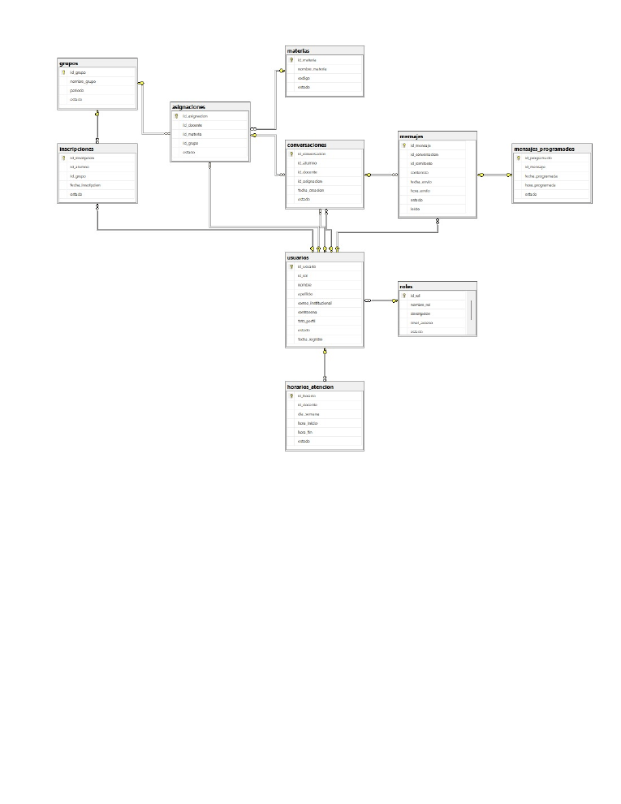

## Mockups por rol

<table>
  <tr><td align="center">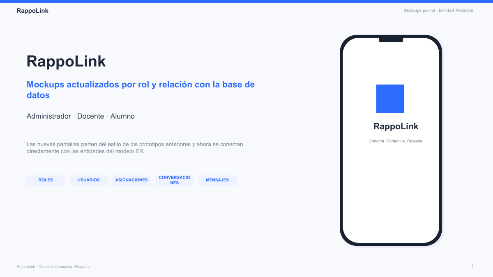 Página 1</td><td align="center">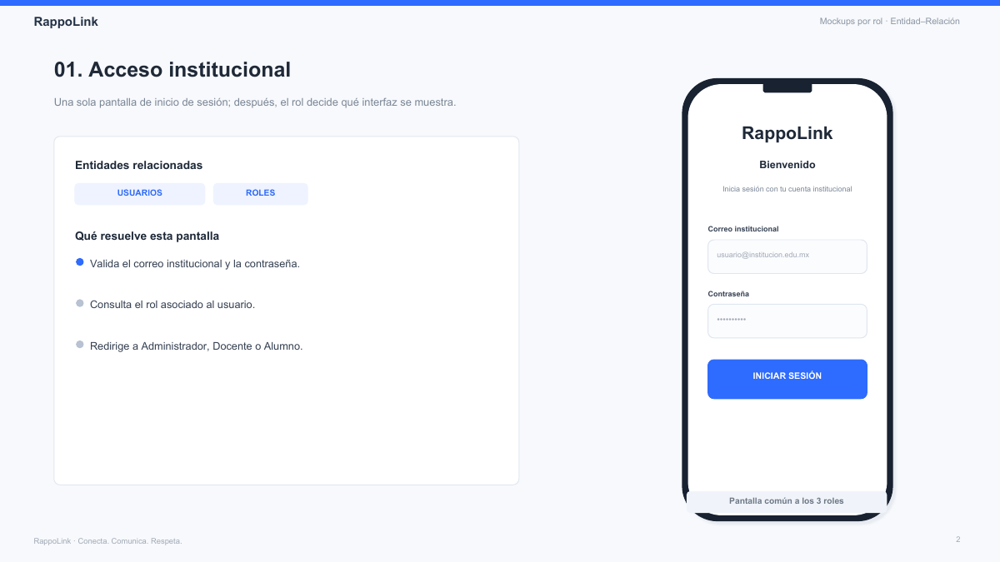 Página 2</td><td align="center">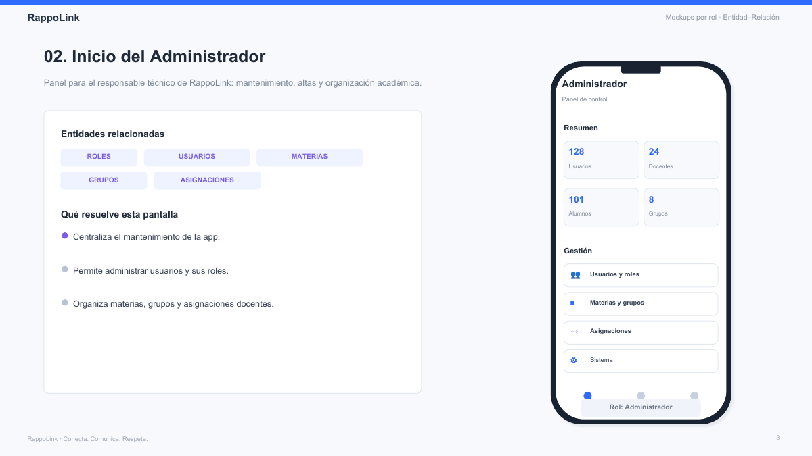 Página 3</td></tr>
  <tr><td align="center">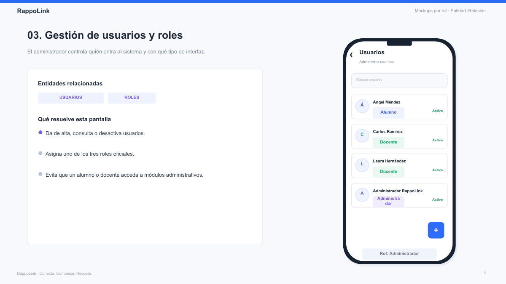 Página 4</td><td align="center">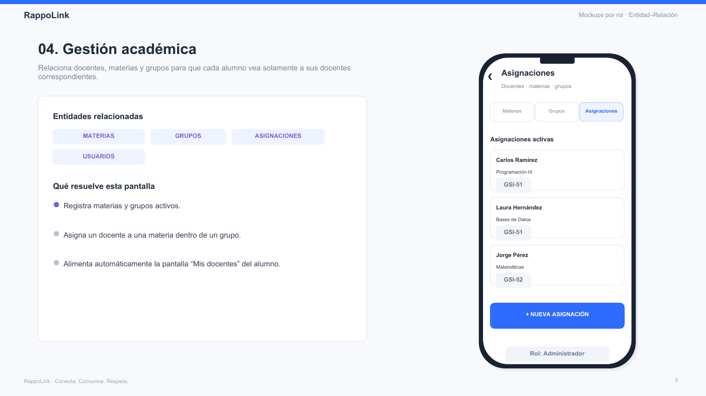 Página 5</td><td align="center">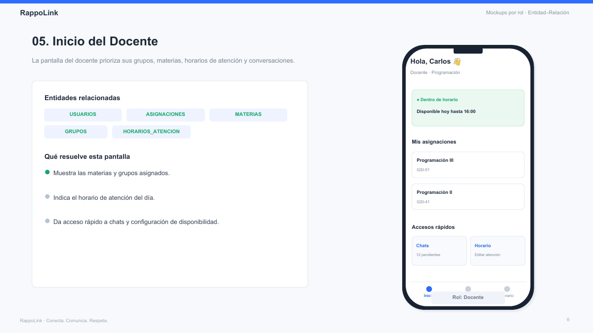 Página 6</td></tr>
  <tr><td align="center">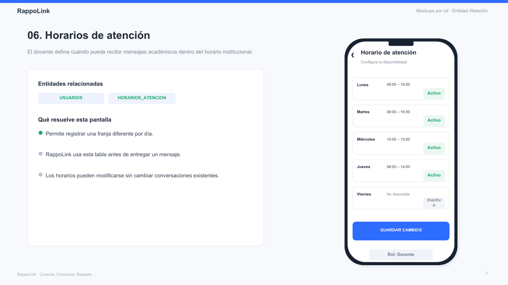 Página 7</td><td align="center">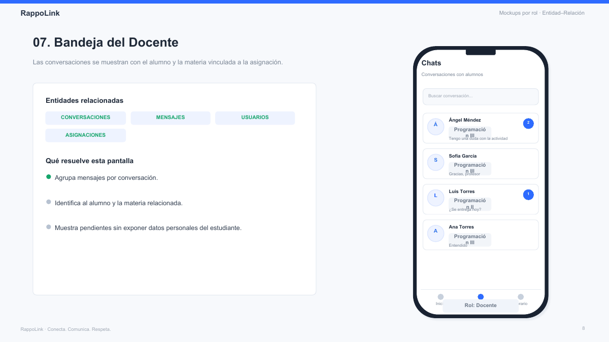 Página 8</td><td align="center">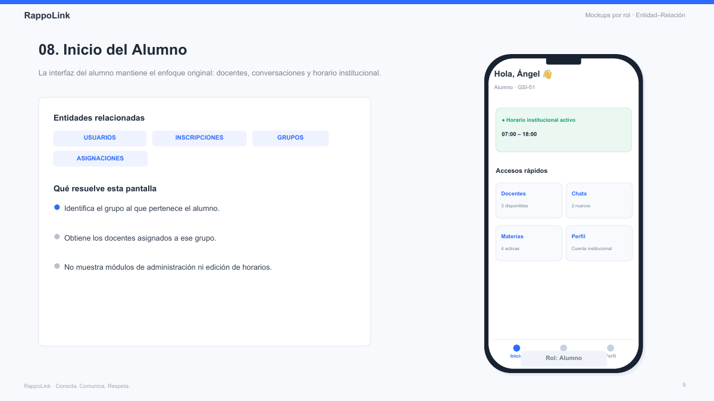 Página 9</td></tr>
  <tr><td align="center">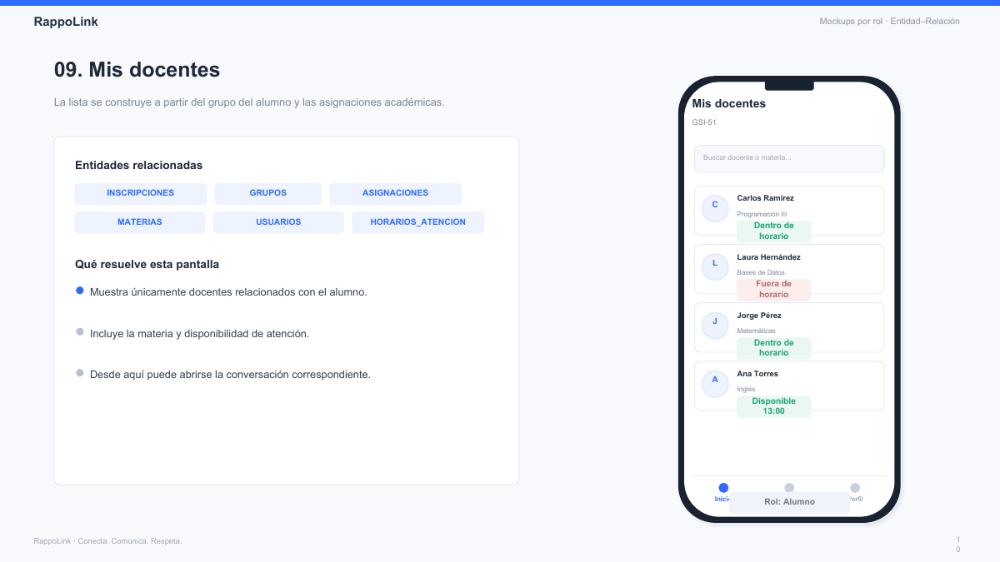 Página 10</td><td align="center">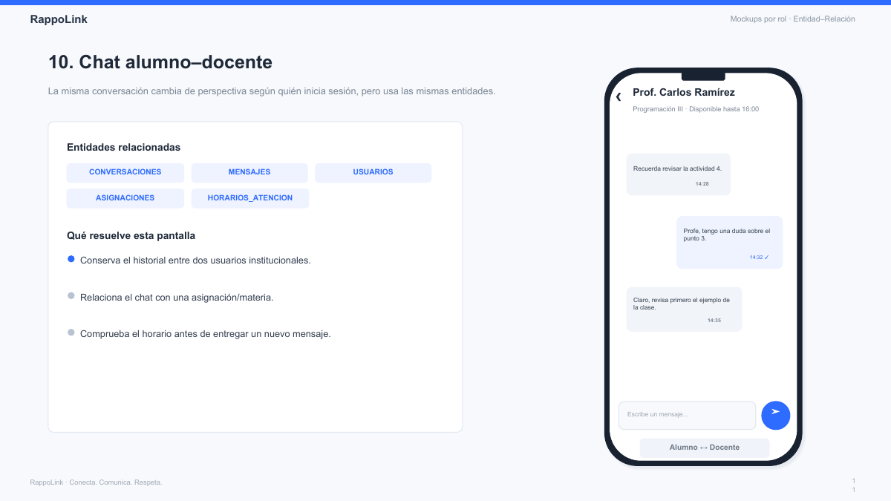 Página 11</td><td align="center">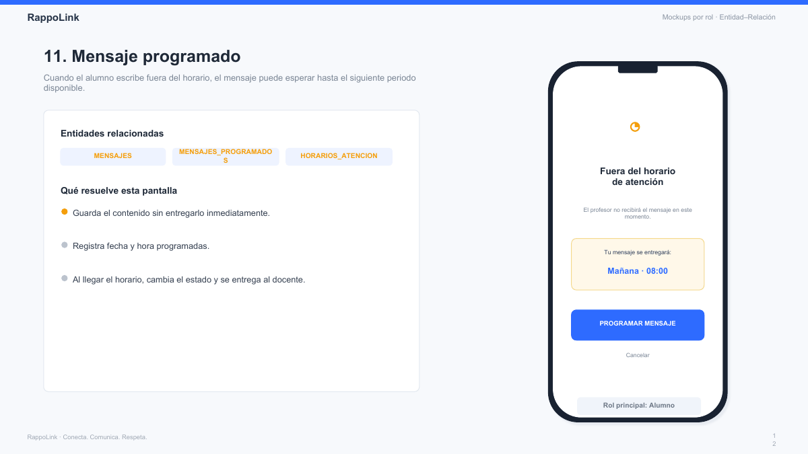 Página 12</td></tr>
  <tr><td align="center">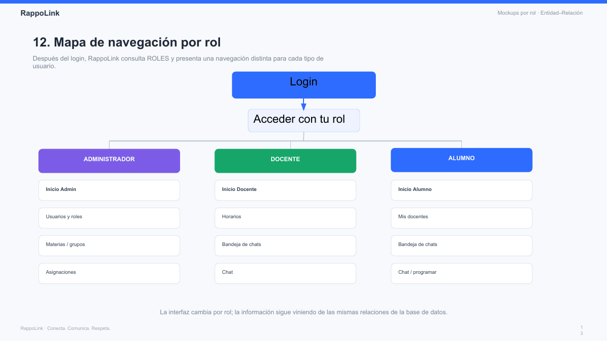 Página 13</td></tr>
</table>
